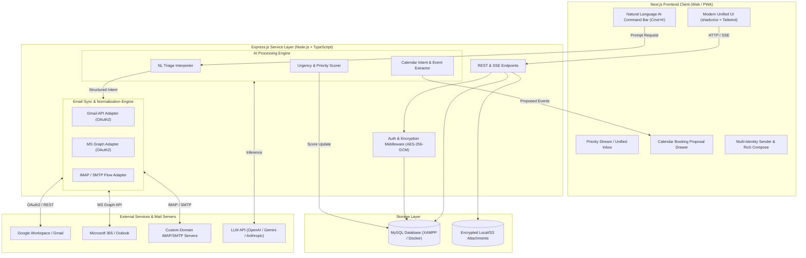
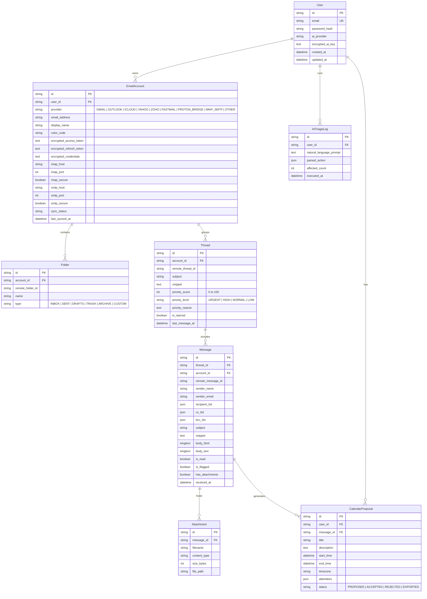
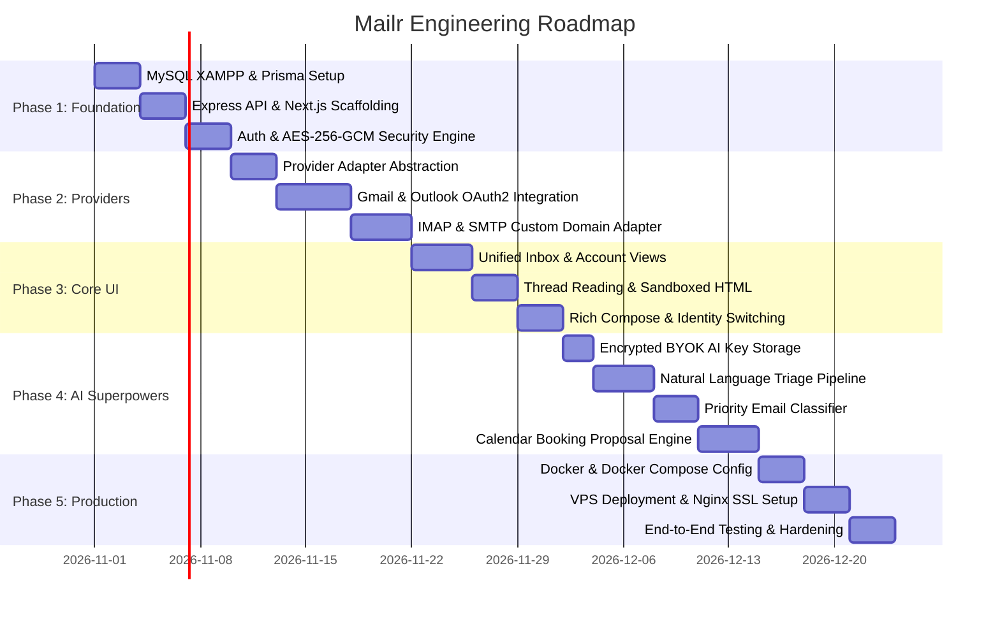

# Mailr — AI-Powered Multi-Account Email Client
## Comprehensive Project Engineering Plan & Implementation Blueprint

---

## 1. Executive Summary & Vision

**Mailr** is a provider-agnostic, AI-powered multi-account email client built for modern professionals, founders, developers, and small teams. It solves inbox fragmentation by allowing users to connect multiple email identities—such as Google Workspace, Microsoft 365, custom domain IMAP/SMTP accounts, and legacy providers—into a unified, responsive interface while maintaining strict account isolation.

Beyond standard email management, Mailr incorporates native **AI capabilities**:
1. **Natural Language Triage**: Execute bulk actions on recent emails using plain language commands (e.g., *"Archive all marketing newsletters from the last 7 days"* or *"Flag unanswered client invoices as urgent"*).
2. **Intelligent Priority Surfacing**: Automatically classify incoming emails and filter your inbox to surface only actionable, high-priority communications (P1 Urgent / Action Required) while silencing noise.
3. **Proposed Calendar Bookings**: Automatically detect meeting intents, extract dates, times, and attendees from message threads, and generate one-click calendar booking proposals (downloadable `.ics` or synced to Google/Outlook calendar).
4. **End-to-End Key & Secret Encryption**: Protect user privacy with zero-knowledge, AES-256-GCM encryption for stored OAuth refresh tokens, IMAP/SMTP credentials, and Bring-Your-Own (BYOK) AI API keys (OpenAI / Anthropic / Gemini).
5. **Turnkey Deployment**: Designed for local development with XAMPP MySQL and production-ready containerization for Docker VPS deployment.

---

## 2. Technical Stack Specification

| Component | Technology | Rationale & Specifications |
| :--- | :--- | :--- |
| **Frontend** | **Next.js 14+ (App Router)** | Server Components, React 18/19, TypeScript, Tailwind CSS, shadcn/ui, TanStack Query (v5), Zustand for local UI state, Lucide React icons. |
| **Backend API** | **Node.js + Express.js** | TypeScript, Express REST API, Server-Sent Events (SSE) / WebSockets for live sync notifications, Zod request validation. |
| **Database** | **MySQL (XAMPP local / MariaDB compatible, MySQL 8.0 on Docker)** | Relational integrity across accounts, threads, messages, and folders. Managed via **Prisma ORM** with connection pooling. |
| **Background Sync** | **BullMQ / Redis or Node-Cron Worker** | Periodic polling of IMAP/SMTP mailboxes and delta sync for Gmail/Graph APIs without blocking HTTP threads. |
| **Mail Protocols & APIs** | **Google APIs, Microsoft Graph, IMAP-Flow, Nodemailer** | Direct adapter pattern wrapping provider-specific APIs and standard RFC 3501 IMAP / RFC 5321 SMTP protocols. |
| **AI Engine** | **LangChain / OpenAI SDK / Google GenAI SDK** | Structured JSON output parsing (Zod schemas) for natural language triage parsing, priority scoring, and calendar event extraction. |
| **Security & Crypto** | **Node.js `crypto` (AES-256-GCM)** | Encrypted token storage at rest with IV and auth tag; PBKDF2/Argon2 key derivation; JWT auth with HTTP-only cookies. |
| **Deployment** | **Docker & Docker Compose** | Multi-container setup (Next.js client, Express API, MySQL 8, Redis, Nginx reverse proxy with Certbot SSL). |

---

## 3. High-Level System Architecture



---

## 4. Database Schema Design (MySQL / Prisma ORM)

The relational schema is configured for MySQL with utf8mb4 encoding, supporting multi-tenancy, token encryption, and AI metadata.



### Prisma Schema (`prisma/schema.prisma`)

```prisma
datasource db {
  provider = "mysql"
  url      = env("DATABASE_URL")
}

generator client {
  provider = "prisma-client-js"
}

enum ProviderType {
  GMAIL
  OUTLOOK
  ICLOUD
  YAHOO
  ZOHO
  FASTMAIL
  PROTON_BRIDGE
  IMAP_SMTP
  OTHER
}

enum FolderType {
  INBOX
  SENT
  DRAFTS
  TRASH
  SPAM
  ARCHIVE
  CUSTOM
}

enum PriorityLevel {
  URGENT
  HIGH
  NORMAL
  LOW
}

enum ProposalStatus {
  PROPOSED
  ACCEPTED
  REJECTED
  EXPORTED
}

model User {
  id                 String             @id @default(uuid())
  email              String             @unique
  passwordHash       String             @map("password_hash")
  aiProvider         String?            @default("openai") @map("ai_provider")
  encryptedAiKey     String?            @db.Text @map("encrypted_ai_key")
  accounts           EmailAccount[]
  triageLogs         AITriageLog[]
  calendarProposals  CalendarProposal[]
  createdAt          DateTime           @default(now()) @map("created_at")
  updatedAt          DateTime           @updatedAt @map("updated_at")

  @@map("users")
}

model EmailAccount {
  id                     String       @id @default(uuid())
  userId                 String       @map("user_id")
  user                   User         @relation(fields: [userId], references: [id], onDelete: Cascade)
  provider               ProviderType
  emailAddress           String       @map("email_address")
  displayName            String       @map("display_name")
  colorCode              String       @default("#3b82f6") @map("color_code")
  encryptedAccessToken   String?      @db.Text @map("encrypted_access_token")
  encryptedRefreshToken  String?      @db.Text @map("encrypted_refresh_token")
  encryptedCredentials   String?      @db.Text @map("encrypted_credentials")
  // Server parameters for IMAP/SMTP & non-OAuth providers
  imapHost               String?      @map("imap_host")
  imapPort               Int?         @default(993) @map("imap_port")
  imapSecure             Boolean      @default(true) @map("imap_secure")
  smtpHost               String?      @map("smtp_host")
  smtpPort               Int?         @default(587) @map("smtp_port")
  smtpSecure             Boolean      @default(false) @map("smtp_secure")
  syncStatus             String       @default("IDLE") @map("sync_status")
  lastSyncedAt           DateTime?    @map("last_synced_at")
  folders                Folder[]
  threads                Thread[]
  messages               Message[]
  createdAt              DateTime     @default(now()) @map("created_at")
  updatedAt              DateTime     @updatedAt @map("updated_at")

  @@unique([userId, emailAddress])
  @@map("email_accounts")
}

model Folder {
  id             String       @id @default(uuid())
  accountId      String       @map("account_id")
  account        EmailAccount @relation(fields: [accountId], references: [id], onDelete: Cascade)
  remoteFolderId String       @map("remote_folder_id")
  name           String
  type           FolderType   @default(CUSTOM)
  createdAt      DateTime     @default(now()) @map("created_at")

  @@map("folders")
}

model Thread {
  id             String        @id @default(uuid())
  accountId      String        @map("account_id")
  account        EmailAccount  @relation(fields: [accountId], references: [id], onDelete: Cascade)
  remoteThreadId String        @map("remote_thread_id")
  subject        String        @db.VarChar(500)
  snippet        String?       @db.Text
  priorityScore  Int           @default(50) @map("priority_score")
  priorityLevel  PriorityLevel @default(NORMAL) @map("priority_level")
  priorityReason String?       @db.Text @map("priority_reason")
  isStarred      Boolean       @default(false) @map("is_starred")
  lastMessageAt  DateTime      @map("last_message_at")
  messages       Message[]
  createdAt      DateTime      @default(now()) @map("created_at")
  updatedAt      DateTime      @updatedAt @map("updated_at")

  @@index([accountId, lastMessageAt])
  @@index([priorityLevel])
  @@map("threads")
}

model Message {
  id                 String             @id @default(uuid())
  threadId           String             @map("thread_id")
  thread             Thread             @relation(fields: [threadId], references: [id], onDelete: Cascade)
  accountId          String             @map("account_id")
  account            EmailAccount       @relation(fields: [accountId], references: [id], onDelete: Cascade)
  remoteMessageId    String             @map("remote_message_id")
  senderName         String?            @map("sender_name")
  senderEmail        String             @map("sender_email")
  recipientList      Json               @map("recipient_list")
  ccList             Json?              @map("cc_list")
  bccList            Json?              @map("bcc_list")
  subject            String             @db.VarChar(500)
  snippet            String?            @db.Text
  bodyHtml           String?            @db.LongText @map("body_html")
  bodyText           String?            @db.LongText @map("body_text")
  isRead             Boolean            @default(false) @map("is_read")
  isFlagged          Boolean            @default(false) @map("is_flagged")
  hasAttachments     Boolean            @default(false) @map("has_attachments")
  receivedAt         DateTime           @map("received_at")
  attachments        Attachment[]
  calendarProposals  CalendarProposal[]
  createdAt          DateTime           @default(now()) @map("created_at")

  @@index([accountId, receivedAt])
  @@index([isRead])
  @@map("messages")
}

model Attachment {
  id          String   @id @default(uuid())
  messageId   String   @map("message_id")
  message     Message  @relation(fields: [messageId], references: [id], onDelete: Cascade)
  filename    String
  contentType String   @map("content_type")
  sizeBytes   Int      @map("size_bytes")
  filePath    String   @map("file_path")
  createdAt   DateTime @default(now()) @map("created_at")

  @@map("attachments")
}

model CalendarProposal {
  id          String         @id @default(uuid())
  userId      String         @map("user_id")
  user        User           @relation(fields: [userId], references: [id], onDelete: Cascade)
  messageId   String         @map("message_id")
  message     Message        @relation(fields: [messageId], references: [id], onDelete: Cascade)
  title       String
  description String?        @db.Text
  startTime   DateTime       @map("start_time")
  endTime     DateTime       @map("end_time")
  timezone    String         @default("UTC")
  attendees   Json
  status      ProposalStatus @default(PROPOSED)
  createdAt   DateTime       @default(now()) @map("created_at")

  @@map("calendar_proposals")
}

model AITriageLog {
  id                   String   @id @default(uuid())
  userId               String   @map("user_id")
  user                 User     @relation(fields: [userId], references: [id], onDelete: Cascade)
  naturalLanguagePrompt String  @db.Text @map("natural_language_prompt")
  parsedAction         Json     @map("parsed_action")
  affectedCount        Int      @default(0) @map("affected_count")
  executedAt           DateTime @default(now()) @map("executed_at")

  @@map("ai_triage_logs")
}
```

---

## 5. Security & Zero-Knowledge Encryption Model

Mailr stores sensitive provider tokens (OAuth refresh tokens, IMAP passwords, and user AI API keys). Storing these in plaintext is a severe vulnerability. We enforce **AES-256-GCM** encryption with authenticated tags.

### Cryptographic Specification:
- **Algorithm**: `aes-256-gcm`
- **Key Derivation**: Master encryption key loaded via secure environment variable (`ENCRYPTION_MASTER_KEY`).
- **Initialization Vector (IV)**: Cryptographically secure random 12-byte IV per encryption operation.
- **Integrity Tag**: 16-byte Authentication Tag generated by GCM to verify ciphertext integrity.
- **Payload Format**: `iv:authTag:ciphertext` encoded in hexadecimal or base64.

### Encryption Utility Implementation (`backend/src/utils/crypto.ts`)

```typescript
import crypto from 'crypto';

const ALGORITHM = 'aes-256-gcm';
const MASTER_KEY = Buffer.from(process.env.ENCRYPTION_MASTER_KEY || '', 'hex');

if (MASTER_KEY.length !== 32) {
  throw new Error('ENCRYPTION_MASTER_KEY must be exactly 32 bytes (64 hex characters).');
}

export interface EncryptedPayload {
  combined: string;
}

export function encryptSecret(plainText: string): string {
  const iv = crypto.randomBytes(12);
  const cipher = crypto.createCipheriv(ALGORITHM, MASTER_KEY, iv);
  
  let encrypted = cipher.update(plainText, 'utf8', 'hex');
  encrypted += cipher.final('hex');
  const authTag = cipher.getAuthTag().toString('hex');
  
  // Format: iv:authTag:ciphertext
  return `${iv.toString('hex')}:${authTag}:${encrypted}`;
}

export function decryptSecret(encryptedPayload: string): string {
  const parts = encryptedPayload.split(':');
  if (parts.length !== 3) {
    throw new Error('Invalid encrypted payload structure.');
  }

  const [ivHex, authTagHex, encryptedHex] = parts;
  const iv = Buffer.from(ivHex, 'hex');
  const authTag = Buffer.from(authTagHex, 'hex');
  
  const decipher = crypto.createDecipheriv(ALGORITHM, MASTER_KEY, iv);
  decipher.setAuthTag(authTag);
  
  let decrypted = decipher.update(encryptedHex, 'hex', 'utf8');
  decrypted += decipher.final('utf8');
  return decrypted;
}
```

---

## 6. Provider Adapter Architecture (Normalization Layer)

To satisfy the product document's core principle—**"Make email provider agnostic"**—Mailr utilizes a pluggable `EmailProviderAdapter` abstraction.

### Adapter Interface

```typescript
export interface NormalizedMessage {
  remoteId: string;
  remoteThreadId: string;
  senderName: string;
  senderEmail: string;
  recipients: string[];
  cc: string[];
  bcc: string[];
  subject: string;
  snippet: string;
  bodyHtml: string;
  bodyText: string;
  receivedAt: Date;
  isRead: boolean;
  isFlagged: boolean;
  hasAttachments: boolean;
  attachments?: {
    filename: string;
    contentType: string;
    sizeBytes: number;
    remoteAttachmentId?: string;
  }[];
}

export interface SendMailOptions {
  from: string;
  to: string[];
  cc?: string[];
  bcc?: string[];
  subject: string;
  bodyHtml: string;
  bodyText?: string;
  attachments?: {
    filename: string;
    content: Buffer;
    contentType: string;
  }[];
}

export interface IEmailAdapter {
  connect(): Promise<void>;
  syncMessages(since: Date, onMessageBatch: (batch: NormalizedMessage[]) => Promise<void>): Promise<void>;
  sendMail(options: SendMailOptions): Promise<{ success: boolean; messageId: string }>;
  markAsRead(remoteMessageId: string, isRead: boolean): Promise<void>;
  archiveMessage(remoteMessageId: string): Promise<void>;
  deleteMessage(remoteMessageId: string): Promise<void>;
  disconnect(): Promise<void>;
}
```

### 6.1 Supported Providers & Implementation Matrix

Mailr provides native adapters for the entire ecosystem of email services:

| Provider Category | Supported Services | Connection Protocol | Auth Mechanism | Capabilities Supported |
| :--- | :--- | :--- | :--- | :--- |
| **Google** | Gmail, Google Workspace | Gmail REST API v1 (`googleapis`) | OAuth 2.0 (PKCE + Offline Refresh) | Labels, History Delta Sync, Threads, Drafts, Server Search |
| **Microsoft** | Outlook.com, Microsoft 365, Hotmail, Live | Microsoft Graph API v1.0 (`@azure/msal-node`) | OAuth 2.0 (Graph Scopes) | Delta Queries, Folders, Categories, Server Search, Send on Behalf |
| **Apple** | iCloud Mail (`@icloud.com`, `@me.com`, `@mac.com`) | IMAP + SMTP | App-Specific Password (AES-256-GCM) | Push IDLE, Standard Folders, Drafts |
| **Yahoo / AOL** | Yahoo Mail, AOL Mail | IMAP + SMTP | OAuth 2.0 or App-Generated Password | Push IDLE, Bulk Folder Sync |
| **Zoho** | Zoho Mail, Zoho Workplace | IMAP + SMTP | App Password or OAuth 2.0 | Multi-datacenter (US, EU, IN), Custom Folders |
| **Privacy / Pro** | Fastmail, Proton Mail (via Bridge) | IMAP + SMTP | Fastmail API / Proton Bridge Local TLS | Local Bridge loopback TLS (`127.0.0.1`), Fastmail JMAP/IMAP |
| **Legacy & Webmail** | Rediffmail, Webmail, cPanel, Plesk | IMAP4rev1 + ESMTP | Encrypted Credentials (AES-256-GCM) | Standard IMAP Flags, RFC 3501 |
| **Custom Domains** | Any personal/company domain (`contact@brand.com`) | IMAP (Port 993/143) + SMTP (Port 587/465) | Automated DNS Auto-Discovery or Manual Config | TLS, STARTTLS, Custom Ports, IDLE Notification |

---

### 6.2 Detailed Provider Adapters

#### 1. Google Mail Adapter (`GmailAdapter`)
- **Protocol**: HTTPS REST (`https://gmail.googleapis.com/gmail/v1/users/me`)
- **OAuth 2.0 Scopes**:
  - `https://www.googleapis.com/auth/gmail.modify` (Read, compose, send, archive, mark read/starred)
  - `https://www.googleapis.com/auth/gmail.labels` (List and manage tags/labels)
  - `https://www.googleapis.com/auth/userinfo.email` & `https://www.googleapis.com/auth/userinfo.profile`
- **Delta Sync Engine**: Stores `historyId` in `SyncState`. Queries `/history?startHistoryId=xxx` to fetch only added, deleted, or label-modified messages without re-downloading entire mailboxes.
- **Normalization**: Maps Gmail Labels (`INBOX`, `SENT`, `TRASH`, `SPAM`, `UNREAD`, `STARRED`) directly into Mailr's normalized folder structure.

#### 2. Microsoft Outlook & 365 Adapter (`OutlookAdapter`)
- **Protocol**: HTTPS REST via Microsoft Graph API (`https://graph.microsoft.com/v1.0/me`)
- **Authentication**: Azure AD / Entra ID App registration with `@azure/msal-node`.
- **OAuth 2.0 Scopes**:
  - `offline_access` (Long-lived refresh tokens)
  - `Mail.ReadWrite` (Message read, flag, move, delete)
  - `Mail.Send` (Send outgoing mail via Graph `/sendMail`)
  - `User.Read`
- **Delta Sync Engine**: Utilizes Microsoft Graph Delta Links (`/me/mailFolders/inbox/messages/delta`). The server stores `@odata.deltaLink` and polls incrementally.

#### 3. Other Major Providers (Pre-Configured Presets)
Mailr eliminates manual configuration headaches for common providers by providing pre-set host, port, and security rules:
- **Apple iCloud**:
  - Incoming IMAP: `imap.mail.me.com` (Port 993, SSL/TLS)
  - Outgoing SMTP: `smtp.mail.me.com` (Port 587, STARTTLS)
  - Auth: Apple ID + 16-character App-Specific Password (encrypted via AES-256-GCM).
- **Yahoo Mail**:
  - Incoming IMAP: `imap.mail.yahoo.com` (Port 993, SSL/TLS)
  - Outgoing SMTP: `smtp.mail.yahoo.com` (Port 465 or 587, SSL/TLS)
- **Zoho Mail**:
  - Incoming IMAP: `imappro.zoho.com` (US) / `imappro.zoho.eu` (EU) / `imappro.zoho.in` (India) (Port 993, SSL/TLS)
  - Outgoing SMTP: `smtppro.zoho.com` (Port 465, SSL)
- **Fastmail**:
  - Incoming IMAP: `imap.fastmail.com` (Port 993, SSL/TLS)
  - Outgoing SMTP: `smtp.fastmail.com` (Port 465, SSL/TLS)
- **Proton Mail**:
  - Leverages Proton Mail Bridge for local end-to-end PGP decryption:
  - Incoming IMAP: `127.0.0.1` (Port 1143, STARTTLS, Bridge Password)
  - Outgoing SMTP: `127.0.0.1` (Port 1025, STARTTLS, Bridge Password)
- **Rediffmail & Regional Webmails**:
  - Incoming IMAP: `imap.rediffmail.com` (Port 993, SSL)
  - Outgoing SMTP: `smtp.rediffmail.com` (Port 587, STARTTLS)

#### 4. Generic IMAP & SMTP Adapter (`ImapSmtpAdapter`)
For custom business domains, self-hosted mailboxes, cPanel, Plesk, Postfix, and Dovecot.
- **Engine**:
  - IMAP: Built on `imapflow` (high-performance async IMAP client supporting RFC 3501, CONDSTORE, IDLE, COMPRESS).
  - SMTP: Built on `nodemailer` with connection pooling and DKIM/SPF compliance.
- **Automated ISPDB & DNS Auto-Discovery**:
  When a user enters an email address (e.g. `alex@startup.io`), Mailr performs automatic server discovery in sequential fallback tiers:
  1. **Mozilla Thunderbird ISPDB Lookup**: `https://autoconfig.thunderbird.net/v1.1/{domain}`
  2. **RFC 6186 DNS SRV Lookups**: Checks `_imaps._tcp.{domain}` and `_submission._tcp.{domain}`
  3. **Standard Host Guessing**: Tests `mail.{domain}`, `imap.{domain}`, and `smtp.{domain}`
  4. **Fallback to Manual Mode**: Displays pre-filled fields allowing the user to customize host, port, security (SSL vs STARTTLS), and authentication type.
- **Pre-Connection Handshake Verifier**:
  Before committing credentials to the database, Mailr executes a simultaneous test handshake:
  ```typescript
  // Verifies IMAP login + TLS handshake and SMTP connection in under 2 seconds
  await Promise.all([
    imapClient.connect(),
    smtpTransporter.verify()
  ]);
  ```
- **Real-Time Push via IMAP IDLE**:
  Maintains persistent low-overhead socket connections listening for `EXISTS` notifications, broadcasting incoming messages to the frontend via Server-Sent Events (SSE) within milliseconds of arrival.

---

## 7. AI Core Feature Specifications

### 7.1 Natural Language Inbox Triage Engine

Users can input natural language commands into a floating command palette (Cmd+K). The system parses user intent into deterministic, atomic database operations.

#### Example Commands:
- *"Mark all newsletters from the last 3 days as read."*
- *"Archive all automated GitHub notifications received this week."*
- *"Star all emails mentioning contract or proposal from @acme.com."*
- *"Find unread emails from client domains and set priority to Urgent."*

#### AI Triage Processing Pipeline:
1. **Input**: User prompt + current user ID + active account filter.
2. **Context Enrichment**: Fetch lightweight metadata of recent messages (Sender, Subject, ReceivedDate, Snippet, Read Status).
3. **Structured Extraction via LLM**: Function calling / Structured Output schema:
```json
{
  "intent": "TRIAGE_EMAILS",
  "filters": {
    "senderDomain": "github.com",
    "receivedAfter": "2026-10-21T00:00:00Z",
    "isRead": false,
    "keywords": ["notification"]
  },
  "action": "ARCHIVE",
  "confirmationMessage": "Archive 14 GitHub notification emails from the last 7 days?"
}
```
4. **Execution & Audit Trail**:
   - Apply batch updates in MySQL.
   - Dispatch background provider sync commands (e.g. Gmail Batch Modify / IMAP MOVE to Archive).
   - Record in `ai_triage_logs`.

---

### 7.2 Intelligent Priority Surfacing

Rather than cluttering users with every newsletter or promotional message, Mailr computes an **Action Urgency Score (0 - 100)**:
- **P1: URGENT (Score 85–100)**: Direct requests from clients/leads, impending deadlines, critical server alerts, direct inquiries requiring response.
- **P2: HIGH (Score 70–84)**: Important project updates, customer support tickets, financial receipts/invoices.
- **P3: NORMAL (Score 40–69)**: General correspondence, internal company newsletters.
- **P4: LOW (Score 0–39)**: Automated alerts, marketing promotions, social notifications.

#### Priority Scoring Logic:
- Analyzes sender relationship, subject urgency, message body imperatives (*"Can you send this by 5 PM?", "Please review the attached contract"*).
- Outputs `priorityScore`, `priorityLevel`, and a 1-sentence `priorityReason` (e.g. *"Client requesting urgent contract signature before tomorrow morning"*).
- The Next.js frontend features a **"Priority Only"** switch that filters the inbox to P1/P2 messages instantaneously.

---

### 7.3 Smart Calendar Booking Proposals

Emails frequently contain informal meeting coordination requests (*"Are you free this Thursday at 3 PM EST for a quick 30-min sync?"*). Mailr parses these dates and creates a calendar booking proposal drawer directly in the message view.

#### Calendar Event Extraction Output:
```json
{
  "hasMeetingIntent": true,
  "confidence": 0.94,
  "proposal": {
    "title": "Quick 30-min Sync: Mailr Architecture Review",
    "description": "Discussing Next.js frontend and Express backend integration for Mailr.",
    "startTime": "2026-10-30T15:00:00-04:00",
    "endTime": "2026-10-30T15:30:00-04:00",
    "timezone": "America/New_York",
    "attendees": [
      { "name": "Sarah Connor", "email": "sarah@cyberdyne.io" },
      { "name": "Parth Gorde", "email": "parth@domain.com" }
    ]
  }
}
```

#### User Actions:
- **One-Click Add**: Adds event to Google Calendar / Outlook Calendar via API or generates a downloadable standard `.ics` iCalendar file.
- **Propose Counter-Time**: AI generates suggested response text with available slots.

---

## 8. Frontend User Experience Specification (Next.js)

### 8.1 Layout & Navigation Architecture
- **Three-Pane Responsive Layout**:
  1. **Navigation Sidebar**:
     - Unified Inbox (`All Accounts`)
     - Priority Stream (AI-filtered)
     - Starred / Flagged
     - Drafts, Sent, Trash, Archive
     - Account List with visual color tags and sync status indicators
     - Settings (Accounts, AI Keys, Security)
  2. **Message List Pane**:
     - Search & Filter bar (Account pills, Unread filter, Date picker)
     - AI Natural Language Omnibar (`Cmd+K`)
     - Thread items displaying:
       * Sender avatar & display name
       * **Account Badge** (e.g. `[Work @ Blue]`, `[Personal @ Green]`)
       * Priority Badge (Urgent, High)
       * Subject line & snippet
       * Attachment indicator paperclip
       * Timestamp
  3. **Reading & Action Pane**:
     - Thread header with reply/forward/archive/delete/move actions
     - Calendar Proposal Banner (if meeting detected)
     - Thread messages with rendered HTML (sandboxed iframe for security)
     - Quick Reply Box with AI suggested replies
  4. **Compose Modal**:
     - "From" identity selector (auto-selects matching account when replying)
     - Rich text editor (TipTap / Lexical)
     - Attachment drag-and-drop
     - AI Draft Assistant ("Expand", "Make more formal", "Summarize")

### 8.2 Account Connection Hub & Provider Setup Modal

When adding a new mailbox, Mailr presents a clean, intuitive provider selection grid designed to handle both modern OAuth flows and custom server setups:

```
+-------------------------------------------------------------------+
|                     Connect an Email Account                      |
|  Select your provider to link your inbox to Mailr:                |
|                                                                   |
|  [ G Google / Gmail ]       [ M Microsoft 365 / Outlook ]         |
|  1-Click OAuth2 Fast Sync   1-Click Graph API Sync                |
|                                                                   |
|  [ A Apple iCloud Mail ]    [ Y Yahoo / AOL Mail ]                |
|  App-Specific Password      App-Generated Password                |
|                                                                   |
|  [ Z Zoho Mail ]            [ F Fastmail / Proton Bridge ]        |
|  US/EU/IN Datacenters       Bridge / App Password                 |
|                                                                   |
|  [ @ Custom Domain / Other IMAP & SMTP ]                          |
|  Auto-Discover DNS / cPanel / Plesk / Self-Hosted                 |
+-------------------------------------------------------------------+
```

#### Custom Domain / IMAP & SMTP Setup Workflow:
1. **Intelligent Auto-Discovery**:
   - The user inputs `you@yourdomain.com` and password.
   - Mailr's backend asynchronously queries DNS MX records and Mozilla ISPDB.
   - If server records are found, the IMAP Host (`imap.yourdomain.com:993`) and SMTP Host (`smtp.yourdomain.com:587`) are automatically populated.
2. **Advanced Manual Configuration Drawer**:
   - **Incoming Mail (IMAP)**: Server Host, Port (993 SSL / 143 STARTTLS), Username, Password, SSL/TLS toggle.
   - **Outgoing Mail (SMTP)**: Server Host, Port (465 SSL / 587 STARTTLS / 25), Username, Password, Auth Type (Plain / Login).
3. **Live Handshake Test Before Saving**:
   - A `"Test Connection"` button triggers an active handshake to both IMAP and SMTP servers.
   - Immediate green status indicator confirms success before saving to MySQL with AES-256-GCM encryption.

---

## 9. Phased Implementation Roadmap



### Detailed Breakdown of Phases

#### Phase 1: Foundation & Infrastructure (Days 1–9)
1. Initialize monorepo or dual-package structure (`mailr-client` & `mailr-server`).
2. Configure MySQL in local XAMPP (`127.0.0.1:3306`).
3. Setup Prisma ORM, migrations, and seed scripts.
4. Build User Auth (JWT in HTTP-only cookies, password hashing with bcrypt).
5. Implement `crypto.ts` for AES-256-GCM encryption/decryption of account tokens and AI keys.

#### Phase 2: Email Connectors & Sync Pipeline (Days 10–21)
1. Implement `IEmailAdapter` base class and normalized data models.
2. Implement `GmailAdapter` using Google OAuth 2.0 and Gmail API.
3. Implement `OutlookAdapter` using MSAL and Microsoft Graph API.
4. Implement `ImapSmtpAdapter` using `imapflow` and `nodemailer` for generic/custom domain mailboxes.
5. Create background sync worker to sync new messages and store them in MySQL.
6. Setup SSE (Server-Sent Events) endpoint to stream new emails to Next.js in real time.

#### Phase 3: Frontend Inbox & Messaging UX (Days 22–31)
1. Build Next.js 14 layout with Tailwind CSS and shadcn/ui.
2. Build Unified Inbox showing consolidated emails with distinct account color badges.
3. Build Account Filter switcher (toggle all vs. individual mailbox).
4. Implement Thread View with sandboxed iframe HTML sanitization (DOMPurify).
5. Implement Compose / Reply modal with sender identity selection.
6. Implement full-text search across all accounts.

#### Phase 4: AI Triage, Priority & Calendar Engine (Days 32–44)
1. Build user settings interface for LLM selection (OpenAI, Gemini, Anthropic) and encrypted BYOK key storage.
2. Build Natural Language Triage Omnibar (`Cmd+K`) with structured LLM output execution.
3. Build Priority Classifier pipeline: score incoming threads (0–100) and render "Priority Only" toggle.
4. Build Calendar Extraction pipeline: detect meeting dates/times/attendees and display booking proposal drawer with `.ics` export and Google Calendar links.

#### Phase 5: Docker Containerization & VPS Deployment (Days 45–53)
1. Write production multi-stage `Dockerfile` for Next.js frontend.
2. Write production `Dockerfile` for Node-Express backend.
3. Build complete `docker-compose.yml` with MySQL 8.0, Redis, API, Web, and Nginx.
4. Configure Nginx reverse proxy with SSL termination via Let's Encrypt Certbot.
5. Conduct security audit, test token revocation, and finalize deployment documentation.

---

## 10. API Route Specification (Express.js)

### Auth & Accounts
- `POST /api/auth/register` — Register primary Mailr user
- `POST /api/auth/login` — Login & receive secure cookie
- `GET  /api/auth/me` — Get authenticated user details & settings
- `POST /api/auth/ai-key` — Encrypt and save user's OpenAI/Gemini API key

### Connected Email Accounts & Provider Management
- `GET    /api/accounts` — List all connected accounts with sync status and provider tags
- `POST   /api/accounts/discover` — Auto-discover IMAP & SMTP settings from email domain (ISPDB / MX)
- `POST   /api/accounts/test-connection` — Live test of IMAP & SMTP credentials before saving
- `POST   /api/accounts/connect/oauth/google` — Initiate/callback Google OAuth (Gmail / Workspace)
- `POST   /api/accounts/connect/oauth/microsoft` — Initiate/callback Microsoft OAuth (Outlook / 365)
- `POST   /api/accounts/connect/preset/:provider` — Connect via preset (iCloud, Yahoo, Zoho, Fastmail, Proton)
- `POST   /api/accounts/connect/imap-smtp` — Connect custom domain / generic IMAP & SMTP account
- `DELETE /api/accounts/:id` — Disconnect account, revoke remote tokens, and wipe encrypted secrets
- `POST   /api/accounts/:id/sync` — Trigger immediate manual mailbox delta sync

### Mailbox & Messages
- `GET    /api/messages/unified` — Paginated unified inbox stream (supports `?priorityOnly=true&accountId=xxx`)
- `GET    /api/threads/:id` — Get full thread conversation with messages
- `POST   /api/messages/send` — Send email from designated identity
- `PATCH  /api/messages/:id/read` — Toggle read/unread state
- `POST   /api/messages/:id/archive` — Archive message locally and remotely
- `GET    /api/messages/stream` — SSE endpoint for real-time mailbox push notifications

### AI Operations
- `POST /api/ai/triage` — Execute natural language triage instruction
- `POST /api/ai/priority/rescore` — Rescore unread messages for priority inbox
- `GET  /api/ai/calendar/proposals` — Fetch pending calendar booking proposals
- `POST /api/ai/calendar/proposals/:id/accept` — Confirm proposal and export `.ics` / sync to calendar

---

## 11. Local Setup Guide (XAMPP MySQL Development)

### Prerequisites:
- Node.js v20+ or v24+
- XAMPP with MySQL module running (Port 3306)

### Step 1: Start XAMPP MySQL
1. Open XAMPP Control Panel.
2. Start the **MySQL** service (Default port: `3306`).
3. Open `http://localhost/phpmyadmin` in your browser.
4. Create a database named `mailr_dev` with collation `utf8mb4_unicode_ci`.

### Step 2: Configure Environment Variables (`backend/.env`)
```env
PORT=5000
NODE_ENV=development
FRONTEND_URL=http://localhost:3000

# XAMPP MySQL Database Connection
DATABASE_URL="mysql://root:@127.0.0.1:3306/mailr_dev"

# 32-byte hex key for AES-256-GCM token encryption (Generate via crypto.randomBytes(32).toString('hex'))
ENCRYPTION_MASTER_KEY=0123456789abcdef0123456789abcdef0123456789abcdef0123456789abcdef

# JWT Secret
JWT_SECRET=super_secret_jwt_key_mailr_local_dev

# Google OAuth Credentials
GOOGLE_CLIENT_ID=your_google_client_id.apps.googleusercontent.com
GOOGLE_CLIENT_SECRET=your_google_client_secret
GOOGLE_REDIRECT_URI=http://localhost:5000/api/accounts/oauth/google/callback

# Microsoft Graph Credentials
MS_CLIENT_ID=your_microsoft_client_id
MS_CLIENT_SECRET=your_microsoft_client_secret
MS_REDIRECT_URI=http://localhost:5000/api/accounts/oauth/microsoft/callback
```

### Step 3: Run Database Migrations
```bash
cd backend
npm install
npx prisma migrate dev --name init
```

### Step 4: Run Application
```bash
# Terminal 1: Backend
cd backend
npm run dev

# Terminal 2: Frontend
cd frontend
npm run dev
```
Access the application at `http://localhost:3000`.

---

## 12. Docker VPS Production Deployment Specification

### Production Architecture
- **Nginx Reverse Proxy**: Directs traffic, handles SSL via Let's Encrypt, routes `/` to Next.js and `/api` to Express.
- **Next.js Frontend Container**: Optimized standalone Node production build.
- **Express Backend Container**: Node.js API with background sync worker.
- **MySQL 8.0 Container**: Persistent volume storage with daily backup volume.
- **Redis Container**: Background queue for email polling and sync jobs.

### `docker-compose.yml` (Production Blueprint)

```yaml
version: '3.8'

services:
  db:
    image: mysql:8.0
    container_name: mailr_mysql
    restart: always
    environment:
      MYSQL_ROOT_PASSWORD: ${MYSQL_ROOT_PASSWORD}
      MYSQL_DATABASE: ${MYSQL_DATABASE}
      MYSQL_USER: ${MYSQL_USER}
      MYSQL_PASSWORD: ${MYSQL_PASSWORD}
    volumes:
      - mysql_data:/var/lib/mysql
    networks:
      - mailr_internal
    healthcheck:
      test: ["CMD", "mysqladmin", "ping", "-h", "localhost"]
      interval: 10s
      timeout: 5s
      retries: 5

  redis:
    image: redis:7-alpine
    container_name: mailr_redis
    restart: always
    volumes:
      - redis_data:/data
    networks:
      - mailr_internal

  backend:
    build:
      context: ./backend
      dockerfile: Dockerfile
    container_name: mailr_api
    restart: always
    depends_on:
      db:
        condition: service_healthy
    environment:
      PORT: 5000
      NODE_ENV: production
      DATABASE_URL: mysql://${MYSQL_USER}:${MYSQL_PASSWORD}@db:3306/${MYSQL_DATABASE}
      REDIS_URL: redis://redis:6379
      ENCRYPTION_MASTER_KEY: ${ENCRYPTION_MASTER_KEY}
      JWT_SECRET: ${JWT_SECRET}
      FRONTEND_URL: https://${DOMAIN_NAME}
    networks:
      - mailr_internal

  frontend:
    build:
      context: ./frontend
      dockerfile: Dockerfile
    container_name: mailr_web
    restart: always
    environment:
      NEXT_PUBLIC_API_URL: https://${DOMAIN_NAME}/api
    networks:
      - mailr_internal

  nginx:
    image: nginx:alpine
    container_name: mailr_nginx
    restart: always
    ports:
      - "80:80"
      - "443:443"
    volumes:
      - ./nginx/nginx.conf:/etc/nginx/nginx.conf:ro
      - ./certbot/conf:/etc/letsencrypt:ro
      - ./certbot/www:/var/www/certbot:ro
    depends_on:
      - frontend
      - backend
    networks:
      - mailr_internal

volumes:
  mysql_data:
  redis_data:

networks:
  mailr_internal:
    driver: bridge
```

---

## 13. Verification & Acceptance Criteria

| Category | Acceptance Criteria |
| :--- | :--- |
| **Multi-Account** | User can connect at least 2 distinct providers (e.g. Gmail + IMAP custom domain) simultaneously. |
| **Unified Inbox** | All incoming emails appear chronologically in unified view with clear color-coded account attribution badges. |
| **Identity Sending**| Composing and replying automatically defaults to the correct receiving account address, preventing cross-account leakage. |
| **NL Triage** | Command palette parses phrases like *"Archive marketing emails from last week"* and executes batch updates safely. |
| **Priority View** | High urgency emails (P1/P2) are surfaced reliably; toggling "Priority Only" filters out non-critical messages. |
| **Calendar Proposals**| Incoming emails with meeting dates/times show an interactive proposal widget with exportable `.ics` or direct calendar sync. |
| **Security** | Sensitive tokens (OAuth refresh tokens, IMAP passwords, AI keys) are encrypted using AES-256-GCM before database insertion. |
| **Deployment** | Entire stack builds and boots cleanly using `docker-compose up -d` on any Ubuntu/Debian VPS. |
